# AA1-Diagnosi-DNS

## 3. Fase Pràctica: Auditoria de resolució de noms (CLI)
Requisits de l'entorn de treball
Sistema operatiu: Màquina virtual amb Zorin OS (o distribució Linux equivalent).

Configuració de xarxa:

Interfície 1 (eth0 / enp0s3): Mode NAT (amb sortida a Internet).

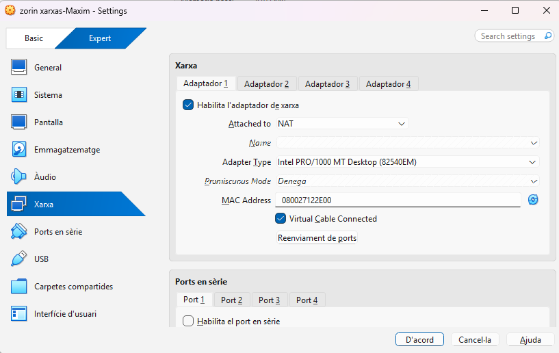

Interfície 2 (eth1 / enp0s8): Mode Adaptador pont (Bridged) amb IP estàtica i paràmetres assignats pel responsable tècnic.

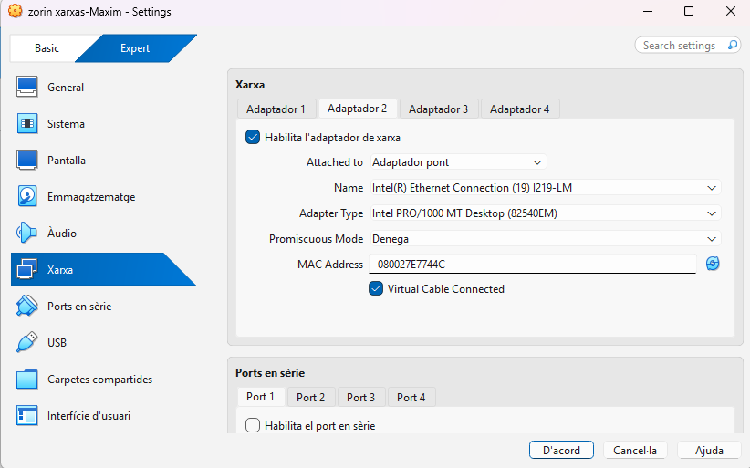

 

## Part A. Diagnosi avançada amb dig (Linux/macOS)
Executeu les comandes següents des de la terminal i incloeu-ne l'anàlisi corresponent utilitzant el domini tecnocampus.cat:

1. Consulta bàsica de registre A:

Bash

dig tecnocampus.cat A

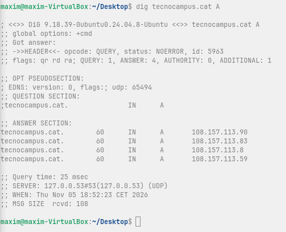

Anàlisi: Identifiqueu la IP de resposta, el valor del TTL i la IP del servidor DNS que ha respost.

* ANSWER SECTION: 108.157.113.90, 108.157.113.83, 108.157.113.8 i 108.157.113.59.   
* Valor del TTL: 60 segons.   
* IP del servidor DNS que ha respost: 127.0.0.53.

2. Consulta de servidors de noms (NS):

Bash

dig tecnocampus.cat NS

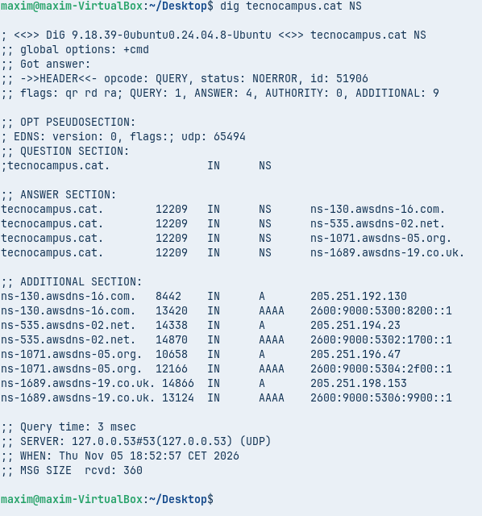

Anàlisi: Indiqueu quins són els servidors de noms (Name Servers) autoritatius per a aquest domini.

**Els servidors de noms autoritatius per a aquest domini són els següents:**

* ns-130.awsdns-16.com.
* ns-535.awsdns-02.net.
* ns-1071.awsdns-05.org.
* ns-1689.awsdns-19.co.uk.

3. Consulta detallada SOA:

Bash
dig tecnocampus.cat SOA

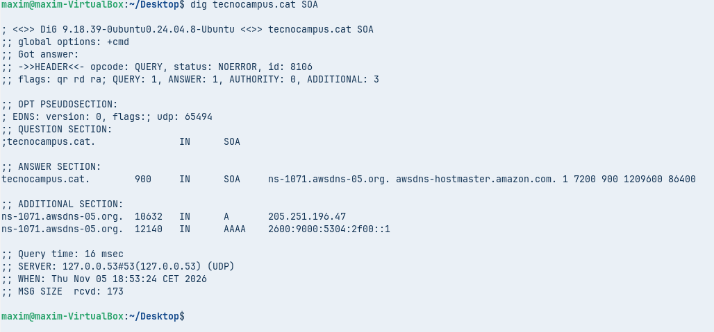

Anàlisi: Identifiqueu el correu de l'administrador (rname) i el número de sèrie (serial) del domini.

* Correu de l'administrador: awsdns-hostmaster.amazon.com.   
* Número de sèrie: 1.

4. Consulta de resolució inversa:

Bash

dig -x <IP_obtinguda_a_la_comanda_1>

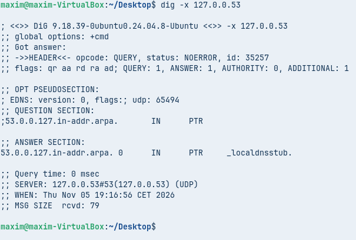

Anàlisi: Detalleu quina informació s'obté dels registres PTR i a quin nom de domini resol la IP introduïda.

Informació dels registres PTR: S'utilitzen per associar una adreça IP a un nom de domini.

Nom de domini al qual resol: L'adreça IP 127.0.0.53 resol al nom_localdnsstub.

## Part B. Comprovació de resolució amb nslookup (Mode interactiu)
Obriu l'eina nslookup en mode interactiu executant nslookup a la terminal fins a veure el prompt (>).

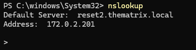

Instruccions de control: set type=TIPUS (defineix el registre: A, NS, SOA, etc.), server IP_o_NOM (canvia el servidor de consulta), exit (surt del prompt).

5. Consulta bàsica no autoritativa:

Dins del prompt, executeu:

Plaintext

set type=A
tecnocampus.cat

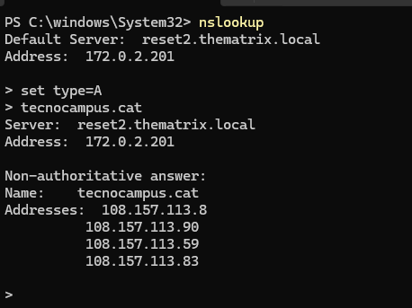

Anàlisi: Analitzeu la resposta obtenguda i indiqueu per què la consola especifica que la resposta és no autoritativa (Non-authoritative answer).

* Origen de la consulta: S'ha fet a un servidor DNS local i no directament als servidors autoritatius oficials del domini.   
* Memòria cau: El servidor local respon amb les dades que té guardades a la seva memòria.

6. Consulta autoritativa directa:

Canvieu el servidor DNS pel primer servidor autoritatiu obtingut a la Comanda 2 (ex. server a9-66.akam.net o la seva IP).

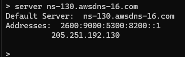

Executeu novament la consulta del registre A per a tecnocampus.cat.

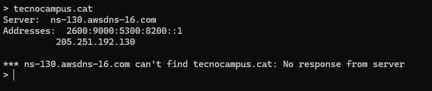

Anàlisi: Compareu la resposta amb la de la Comanda 5 i confirmeu si l'indicador "no autoritatiu" ha desaparegut.

* Comanda 5: El servidor local va retornar les IP correctament però indicant que la resposta venia d'una memòria cau intermediaria.
* Comanda actual: Al intentar consultar directament el servidor autoritatiu, la consola mostra un error de temps d'espera. 

## Part C. Resolucions locals i protocol mDNS
Comproveu la resolució local entre equips de la mateixa xarxa sense servidor DNS dedicat:

Verifiqueu el nom d'host (hostname) de la vostra màquina Zorin OS amb la comanda hostname.

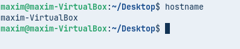

Des d'un altre equip de la mateixa xarxa local (o xarxa bridged), executeu:

Bash
ping <hostname>.local

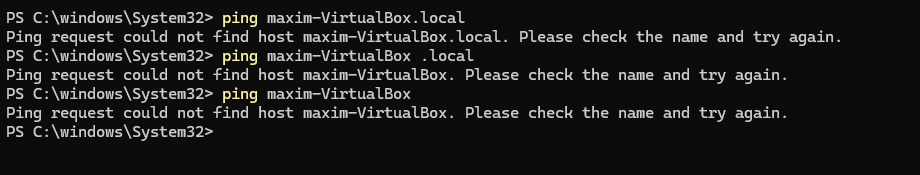

Anàlisi: Descriviu el funcionament del protocol mDNS (Multicast DNS), quin port utilitza (UDP 5353) i quin avantatge aporta en entorns sense servidor DNS configurat.

## MAPA CONCEPTUAL

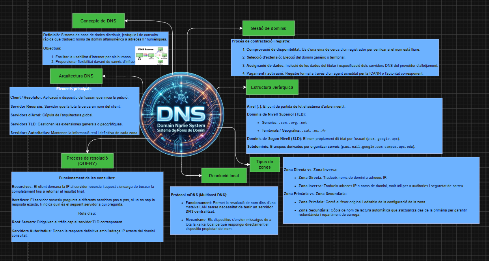

## FONTS i EINES UTILITZADES

* Apunts del mòdul 0227 Serveis de xarxa

* Pàgines de manual: man dig, man nslookup

* Imatge central DNS mapa conceptual: [Conversa Gemini DNS logo](https://share.gemini.google/6Lepg4t1xfxm)

* Eines: ip, dig , nslookup, hostname a Zorin OS i ping a Windows PowerShell.